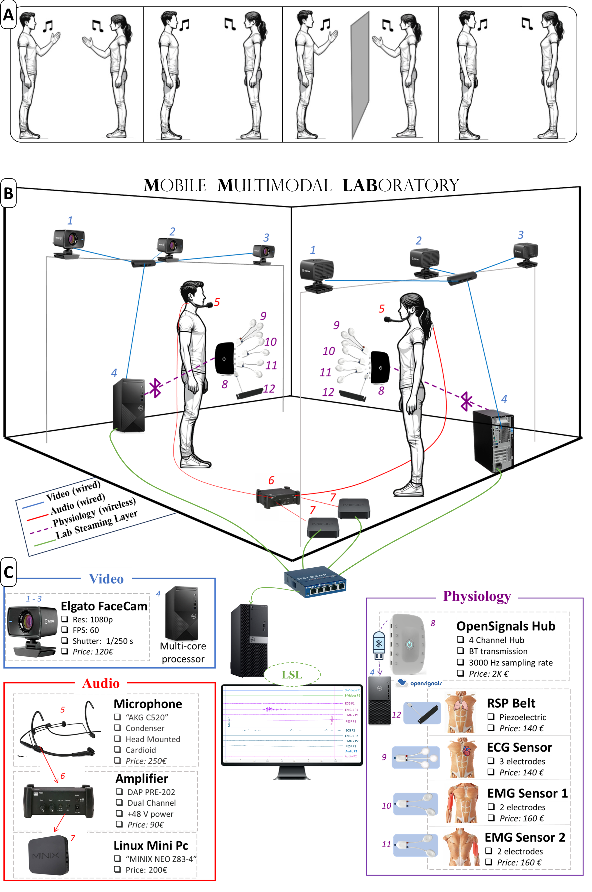

# Multimodal Analyses {#sec-analysis}

::: {.content-visible when-format="html"}
Following multimodal signal processing (@sec-process), we now possess, for each trial, a single time-aligned CSV file containing the processed signals from all modalities (right_index finger motion in x-y-z axes, audio envelope, ECG, respiration, EMG biceps and EMG triceps) for both participants on a common 1 kHz time axis.

:::

In this section, we outline a proof-of-concept analysis pipeline of mutual information (MI) to assess whether interpersonal vision and movement modulate the degree of physiological and behavioural coupling between co-singing participants. We will describe the steps involved in (4.1) preparing and normalizing the signals and (4.2) performing the MI analyses. 

::: {.content-visible when-format="html"}
All analyses were performed using the following Python script: 
 [Quarto Link with Script and Explanation  MML_Mutual_Information_Analyses.ipynb ]

:::

## Signal Normalization {#sec-analysis-norm}
Because these signals originate from different modalities with different physical units and amplitude ranges (e.g., volts for ECG, metres for motion, normalized amplitude for audio), each signal was first z-scored (mean subtracted and divided by the standard deviation), placing it on a common numerical scale so that the subsequent density estimation is not biased by differences in raw units or amplitude ranges.

::: {.content-visible when-format="html"}
[CODE: 4b_SynchronyAnalyses/MML_Mutual_Information_Analyses.ipynb#mi-zscore]

:::

## Mutual Information (MI) Analyses {#sec-analysis-mi}
To quantify the statistical dependency between the two participants’ continuous signals we used MI, a measure grounded in information theory and closely related to Shannon entropy [@shannonMathematicalTheoryCommunication1948]. MI captures how much knowing the value of one signal reduces the uncertainty about the other in both linear and non-linear dependencies, expressed in a non-negative scale where 0 indicates no statistical dependency and higher values indicating stronger coupling (with no upper-bound)

Computing MI requires estimating how likely each signal is to take certain values (its *marginal density*), and how likely two signals are to take specific combinations of values at the same time point (their *joint density*). Because our signals are continuous-valued, these densities cannot be obtained by counting occurrences (as one would do with discrete signals) and must instead be estimated. Therefore, we used Gaussian Kernel Density Estimation (KDE) from `scipy` package to capture *smooth probability density functions* as estimates of these densities [@silvermanDensityEstimationStatistics1986]. KDE works  by centering a small Gaussian curve on every individual data point and aggregating them, resulting in a series of curves that accumulate into high-density peaks where data points overlap frequently or low peaks in regions where data is sparse.The width of each Gaussian kernel was determined automatically based on the spread of the data (using automatic bandwidth selection). This procedure was applied three times per signal pair: once for each of the two signals individually (yielding the *marginal* densities) and once for the two participants’ corresponding signals jointly in two-dimensional space (yielding the *joint* density). 

::: {.content-visible when-format="html"}
[CODE: 4b_SynchronyAnalyses/MML_Mutual_Information_Analyses.ipynb#mi-kde]

:::

MI was then computed by comparing the joint density against the product of the two marginal densities. Under statistical independence, the joint density would equal the product of the marginals exactly (i.e., knowing one signal would give no information about the other). MI quantifies the departure from this independence assumption by evaluating the log-ratio of the joint density to the product of the marginals, weighting each log-ratio by the joint density, and integrating numerically over the full density surface. The resulting value is expressed in nats (natural logarithm units) and is always non-negative. 

::: {.content-visible when-format="html"}
[CODE: 4b_SynchronyAnalyses/MML_Mutual_Information_Analyses.ipynb#mi-compute]

:::

To ensure that the MI estimate captured dependencies even when one signal slightly leads or trails the other, MI was computed at seven time lags (−300, −200, −100, 0, +100, +200, and +300 ms) per signal pair. After each lag-based subsetting, both signals were smoothed with a Savitzky–Golay filter (window = 100 ms, polynomial order = 2) to reduce residual sampling jitter. The maximum MI value across all lags was retained as the summary coupling statistic for each pair.

::: {.content-visible when-format="html"}
[CODE: 4b_SynchronyAnalyses/MML_Mutual_Information_Analyses.ipynb#mi-lag-smooth]

:::

This analysis was applied in a sliding-window fashion across each trial, using 5-second windows advancing in 1-second steps, yielding a time-resolved estimate of coupling strength. Windows containing fewer than 100 time points, or fewer than 50 valid (non-NaN) samples for either variable, were excluded. 

::: {.content-visible when-format="html"}
[CODE: 4b_SynchronyAnalyses/MML_Mutual_Information_Analyses.ipynb#mi-window]

:::

MI was computed for all 64 between-participant signal pairs (8 signals: right_index x-y-z, audio, respiration, ECG, EMG_bicep, EMG_tricep; for P1 and P2) covering both within-modality coupling (e.g., Audio P1 - Audio P2) and cross-modality coupling (e.g., Audio P1 - ECG P2). Though within-participant pairs were computed, the analysis focuses exclusively on interpersonal coupling. Each window's result was stored with its condition labels (Vision/NoVision × Movement/NoMovement), trial identifier, window index, and the pair classification.

::: {#fig-analysis fig-scap="Conceptual illustration of Mutual Information Analysis"}
{width=90%}

NEED THE PROPER FIGURE Two interacting participants are shown (P: left; P2: right)  each with their recorded signals: motion tracking (camera, blue) audio (microphone, red), ECG (heart, purple), respiration (lungs, purple) and EMG (bicep and tricep, purple). Each full circle represents the entropy of one signal: H(X) for P1 and H(Y) for P2. The overlap, I(X;Y), is the mutual information, i.e., how much knowing one reduces uncertainty about the other. The non-overlapping parts of each circle, H(X|Y) and H(Y|X), are the uncertainty that remains in each signal once the other is known. The total area covered by both circles is the joint entropy, H(X,Y). 
:::
