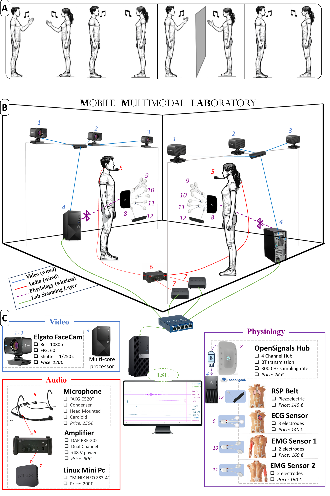

# Set-Up of the MMLab {#sec-setup}
This section provides a practical guide on how to assemble each component used in our MMLab default setup, along with the procedures for operating the recording systems during data acquisition. As mentioned in the introduction, our choices of equipment were guided by the principles of *(1) accessibility*, *(2) affordability*, *(3) portability*, *(4) integration*, *(5) modularity* and *(6) community-maintenance*. Importantly, we do not endorse any particular manufacturer and, although we describe the exact brands models used in our setup, alternative components can be substituted provided they meet similar technical specifications. An overview of the full lab configuration, including a depiction of the experimental design, is provided in Figure 1. In what follows, we first elaborate on the data streams and recording devices included in the current version of MMLab; and finish with integration of all streams under one central clock via LabStreamingLayer (LSL).

::: {#fig-overview fig-scap="Overview of experimental design, MMLab setup and equipment specifications"}
{width=90%}

\(A) Experimental design depicting the 2x2 factorial design in the structured singing task. In the Vision conditions (most-left, middle-left) participants face each other directly, whereas in the NoVision conditions (middle-right, most-right) a visual barrier prevents mutual visual access. In the Movement conditions (most-left, middle-right), participants are free to move naturally while singing, whereas in the NoMovement conditions (middle-left, most-right) they are instructed to remain still. (B) Illustration of the MMLab setup used in the experiment. Each participant is recorded by three frame-synchronized cameras (Video: blue lines, wired to a Window-based PC), a head-mounted microphone (Audio: red lines, wired to amplifier and a Linux-based mini PC), two electromyographical sensors, one electrocardiogram sensor and one respiration belt (Physiology: purple dashed lines, wireless Bluetooth transmission to the Windows PCs). The Video and Physiology streams from the two Windows PCs and the Audio streams from the two Linux mini-PCs were integrated over a wired local network LSL system (Lab Steaming Layer: green, wired to a third Windows-based PC). (C) Equipment specifications and pricing information for the LSL (top, green), Video (bottom, blue), Audio (left, red) and Physiology (right, purple). 
:::

## Video {#sec-setup-video}
### Choosing the Video Recording Setup
The MMLab camera setup is primarily optimized for video-based, whole-body 3D motion tracking (MT). Thanks to rapid advancements in motion analysis technologies and fueled by growing interest across research and clinical domains, there are many MT systems available on the market, each offering distinct strengths and trade-offs [for a comprehensive review of different systems see @vanschaikMotionTrackingDevelopmental2020]. For our MMLab setup, we opted for a video-based MT workflow (using computer-vision model for pose estimation from video recording) rather than device-based systems (which use dedicated sensors to capture movement), since it best aligns with our five core requirements. In fact, while device-based systems (e.g., *Vicon* or *Qualysis*) can reach sub-millimeter accuracy, they come at a steep financial cost [typically > €100,000 or more for full systems, see @vanderkrukAccuracyHumanMotion2018; @vanschaikMotionTrackingDevelopmental2020]. In contrast, video-based solutions using consumer-grade cameras can be implemented for under €1,000, making them orders of magnitude more affordable. Importantly, video-based MT workflows still maintain high levels of precision that are sufficient for most behavioral studies, with acceptable loss of accuracy compared to state-of-the-art device-based systems for many tasks [for performance comparisons between video-based and device-based systems, see @koulHowAccuratelyCan2025; @martiniEnablingGaitAnalysis2022; @otaVerificationReliabilityValidity2020; @pouwQuantificationGestureSpeech2020]. 

Additionally, the free and open-source nature of most computer-vision models – such as *OpenPose* [@caoOpenPoseRealtimeMultiPerson2019] or *Mediapipe* [@lugaresiMediaPipeFrameworkBuilding2019] – has dramatically improved the accessibility of MT for many researches that do not have access to proprietary hardware (and their black-boxed software). Finally, in contrast to the complex, expensive-to-insure, and sometimes bulky nature of device-based motion tracking systems, video-based MT setups can consist of lightweight, and portable components (e.g., USB-cameras, foldable tripods, and a laptop). This makes them ideal for mobile research settings and, notably, particularly suitable for studying diverse populations like human infants and non-human animals, as they do not require wearable sensors or body markers [@bialekOpenSourceStandardizedPipeline2025].  

### Video-Recording Equipment Specs
The video-recording setup of MMLab comprises six USB cameras mounted on two movable arches, with three cameras assigned to (i.e., facing) each participant. Each triplet of cameras was connected to a dedicated recording computer (Dell Precision 3640 Tower) to manage the video streams independently for each participant. To improve portability, the camera arches can be replaced with foldable tripods provided that each camera remains fixed during recording and positioned approximately at the participants’ head height across all sessions. Although a single front-facing camera is sufficient for basic 2D body pose estimation, using three simultaneous viewpoints allows for triangulation in 3D space (i.e., pose estimation includes depth dimension). For the cameras, here we chose the Elgato Facecam (model: Full HD). Each unit is relatively inexpensive (~€120), lightweight (96 g), capable of recording in full-HD resolution (1080p) at 60 Hz, and comes with free software (Elgato Camera Hub) that allows for adjusting camera settings. Crucially, the cameras have modifiable shutter speeds (up to 1/250s), which is an important component for motion tracking, as lower shutter speeds (below 1/100s) tend to introduce motion blur that can impair pose estimation accuracy (see Supplementary Material, **section X**). Naturally, other camera models can be utilized, as long as they allow for shutter speeds above 1/100s.

::: {.content-visible when-format="html"}
[ Quarto only: Supplementary Materials Section 1 See here for shutter speed analyses. ]
In video recording, shutter speed refers to the length of time the camera captures light in each frame and is typically expressed as a fraction of a second (e.g., 1/100s). By allowing more light in each frame, a slower shutter speed can cause motion blur in the resulting video if the objects are moving rapidly within the frame. This is particularly relevant for video-based MT systems, which rely on the visual clarity of body landmarks being consistently detectable in each frame. Motion blur reduces the sharpness of these features, making it more difficult for pose estimation algorithms (e.g., MediaPipe, OpenPose, or DeepLabCut) to correctly track landmarks over time. As a result, lower shutter speeds can lead to missed detections, decreased confidence scores, and greater frame-to-frame jitter in landmark trajectories.
To empirically demonstrate these effects, we recorded two videos from three synchronized webcams of the same fast-moving gesture (a side-to-side hand-waving motion) at 1/60s (slow) and 1/250s (fast) shutter speeds, as shown in Figure S1, A. We then processed both videos using Mediapipe Holistic to extract the frame-by-frame 3D landmarks for the moving (right) hand and the stationary (left) hand (21 landmarks each). For each camera viewpoint,  we quantified 2 key motion tracking metrics: (i) motion jitter - calculated from the frame-to-frame second derivative of the wrist landmark’s 3D trajectory - and (ii) hand visibility - defined as the proportion of frames in which any hand landmarks were detected.  Compared to the default 1/60s setting, the faster shutter speed (1/250s) led to substantial improvements in tracking of the moving hand, as visible in substantial reduction in motion jitter (Figure S1, B) and marked improvements in hand visibility  (Figure S1, C)

Figure S1. Effects of Shutter Speed on Video-Based Motion Tracking Accuracy. (A) Example frames from the three synchronized webcam views during the fast hand gesture (right hand moving laterally, left hand stationary). Red markers indicate body, hand, and face landmarks extracted by MediaPipe Holistic. (B) Motion jitter values by camera (left) and by hand (right), computed as the frame-to-frame second derivative of the wrist landmark’s 3D position. Faster shutter speed (1/250s) significantly reduced jitter for the moving hand.
(C) Hand visibility by camera and hand (left), and percentage improvement in visibility for the faster shutter speed (right). Visibility was defined as the proportion of frames in which any hand landmarks were detected. Faster shutter speed (1/250s) improved tracking robustness for the moving hand across all views, with gains up to +10.7%.

[ Quarto only: see here for more information on the camera and computer equipment ]
Each trio of cameras was fed to a Windows PC equipped with a multi-core processor (e.g., Intel i7 or equivalent) capable of encoding and processing the three video streams in parallel. To prevent bandwidth overload and reduce the risk of dropped frames, two of camera-to-PC connections were mediated by a powered USB hub and distributed across separate USB buses wherever possible (e.g., by allocating one camera to a USB 3.0 port and the remaining cameras to separate USB 2.0 controllers). Alternatively, one may use longer Active Optical Cables (AOC) that ensure reliable data transfer over extended distances while maintaining full USB bandwidth, however, this approach still requires the PC to have sufficient separate controller boards to accommodate each camera independently. 

:::

### Video Recording Procedures 
Before recordings, each camera setting was manually configured through the Elgato Camera Hub software to ensure optimal conditions for MT. Specifically, we set the shutter speed to 1/200s to reduce motion blur, downsampled the image resolution to qHD (960 × 540) to minimize data storage demands, and fixed the ISO at 354 to stabilize image brightness and contrast under short exposure times. 

::: {.content-visible when-format="html"}
[Quarto: here can be screenshot from Elgato Hub]
Figure S2. The Elgato Hub Interface 

[Quarto Link with Script and Explanation. MML_Video3Cameras_LSL.py]
[SCRIPT: 1_LAB_SETUP/VIDEO/MML_Video3Cameras_LSL.py]

:::

We use a custom Python script to record each trio of cameras as a single side-by-side composite video (i.e., concatenating the three feeds horizontally into one file) on two separate computers. This design choice reduces data management overhead compared to handling three separate video files per participant per session. This script leverages the `OpenCV` [@bradskiOpenCVLibrary2000] and `FFmpegCV` **(Chen, 2022)** libraries to feed the combined side-by-side videos from the three cameras into a single compositive video using multithreading, which ensured that all frames were synchronized for each sampling timepoint. To facilitate future processing and debugging, a running frame counter is overlaid on the top-right corner of each of the three concatenated camera views. The video is recorded at 60 Hz in an uncompressed format to preserve image fidelity during acquisition. The script also simultaneously handles LSL integration to allow for post-hoc synchronization of the videos with the other data streams (see @sec-setup-lsl-integr). 

After each session, the raw videos were compressed using the XVID codec at a 2.5x reduction ratio to ease data transfer and storage space using another custom made Python script.

::: {.content-visible when-format="html"}
[Quarto Link with Compression Script and Explanation. MML_compression.py]
[SCRIPT: 1_LAB_SETUP/VIDEO/MML_Video3Cameras_LSL.py]
:::

**1.1.4 - Camera Calibration Procedures:** To ensure 3D pose estimation from multi-angle recordings, video-based MT algorithms require prior information on the intrinsic parameters (e.g., focal length, distortion coefficients) and extrinsic parameters (i.e., spatial orientation and position relative to other cameras) of each device [for more information, see @karashchukAniposeToolkitRobust2021]. Therefore, before each recording, we performed a calibration procedure for each trio of cameras assigned to a participant. Specifically, we recorded a short (∼1-minute) calibration video using a ChArUco board calibration board (see Figure S2) that was moved systematically throughout the full vertical and horizontal space later occupied by the participant during the experiment. These calibration videos were then used to compute the geometric parameters for 3D triangulation during MT (see @sec-process-mt-mt).

::: {.content-visible when-format="html"}

Figure S1. Example of Calibration Videos using the ChArUco

:::

## Audio {#sec-setup-audio}
### Choosing the Audio Recording Setup
To obtain a good level of acoustic fidelity, in our MMLab we opted for a high-quality, head-mounted condenser microphone recording independently from the cameras. The reason why we use separate microphones instead of the built-in camera microphone is that the audio quality of these microphones is typically insufficient for high-resolution analyses of speech features such as pitch, intensity and prosody [@svecGuidelinesSelectingMicrophones2010]. Additionally, to stream the audio signal to the LSL, we opted for a Linux-based PC over Windows or macOS because it enables real-time streaming of low-latency, high precision audio thanks to its Advanced Linux Sound Architecture (ALSA). 

### Audio Recording Equipment
For the microphone, we employed a professional-grade, head-mounted condenser microphone (model: *AKG C520*, price ~€250) for each participant, as shown in Figure 1C. The head-mounted configuration was important for maintaining a fixed distance between the participant’s mouth and the microphone capsule (essential for measurement of speech amplitude and prosodic features), whilst the cardioid polar pattern further focused sensitivity toward the speaker’s mouth and rejected off-axis environmental noise. Additionally, its built-in shock-mount system helped reduce the mechanical noise generated by body movements. Both microphones were powered via a XLR connection to a DAP PRE-202 low-noise, 2-channel digital amplifier (price: ~€90), which provided a +48V phantom power and included a low-cut filter to suppress low-frequency ambient noise. Input gain on the amplifier was manually fixed at 25% across all recordings to standardize signal levels. From the amplifier, the signal from each microphone was routed via two XLR-to-USB interfaces to two MINIX NEO z83-4 MAX Linux-based mini-PC (price: ~€170). 

### Audio Recording Procedures
To record and stream the audio to the LSL, we used a custom-made Python script developed in collaboration with Technical Support Group (TSG) at the Donders Institute. 

::: {.content-visible when-format="html"}
[Quarto Link with Mic Script and Explanation. MML_Microphone.py]
[SCRIPT: 1_LAB_SETUP/AUDIO/MML_AudioLSL_Linux_Alsa.py]

:::

The script was executed on each MINIX Linux device and utilized the `alsaaudio` library to record each signal in mono at a sampling rate of 16 kHz, with 16-bit little-endian encoding optimized for low-latency buffering. This data is directly streamed to the LSL software for multimodal integration and synchronization (see @sec-setup-lsl-integr). Additionally, to ensure data quality before acquisition and monitor issues such as noise artifacts, clipping, or dropouts, we used a secondary Python script that allowed for real-time graphic visualization of the incoming audio stream.

::: {.content-visible when-format="html"}
[Quarto Link with Audio Plot Script and Explanation. MML_Mic_Ploting.py]
[SCRIPT: 1_LAB_SETUP/AUDIO/MML_Mic_Plotting.py]

This script pulled the audio stream from LSL and plotted it on a live display that was continuously updated, enabling it to verify waveform quality and monitor for issues such as noise artifacts, clipping, or dropouts. 

:::

## Physiology (ECG, EMG, RESP) {#sec-setup-physio}
### Choosing the Physiological Setup
In addition to the video and audio modalities, our MMLab default setup also includes wireless physiological recordings. We selected three modalities that are among the most commonly used in multimodal behavioral research and that are particularly relevant to our proof-of-concept paradigm: electrocardiography (ECG), to capture heart rate dynamics and cardiac synchrony between participants, respiration sensor to measure respiratory activity at the thorax, which is closely tied to vocal production and therefore especially pertinent in a singing task, and surface electromyography (EMG) from the biceps and triceps, to record muscle activation patterns during co-singing gestures. Among all the available proprietary options, we chose the “Biosignals PLUX” recording system for the following reasons: (i) it supports a modular sensor architecture, allowing researchers to buy only the biosensors relevant to their experimental goal; (ii) it transmits all the signals wirelessly (BT), thus granting participants free movement during recordings;  (iii) it can be easily integrated with the LSL system, which simplifies synchronization with the other measurements and, finally, it offers a (iv) strong price/quality balance. 

### Physiological Recording Equipment
As shown in Figure 1C, the equipment consisted of two (one per participant) “biosignalplux Hub” (price: ~€2000, [link](https://www.pluxbiosignals.com/products/4-channel-biosignals-kit)), each supporting up to 4 input channels and capable of sampling at rates of up to 3000 Hz per channel with 16-bit resolution (Note that an 8-channel biosignalplux Hub is also available, costing ~€4000, [link](https://www.pluxbiosignals.com/products/8-channel-biosignals-kit?pr_prod_strat=e5_desc&pr_rec_id=da6ceffd3&pr_rec_pid=9167132000581&pr_ref_pid=9167112405317&pr_seq=uniform)). These devices transmitted data wirelessly via bluetooth in real time to their respective recording computers (the same used for video recordings) using a dedicated bluetooth dongle.

To record participants’ muscle activity, we used two surface EMG sensors per participant (price ~€170, link), one placed over the biceps brachii and one over the triceps brachii of the right arm, allowing us to monitor the activation patterns of both flexor and extensor muscle groups.

::: {.content-visible when-format="html"}
As shown in Figure S3, the  electrodes were positioned in a bipolar configuration and aligned with the longitudinal axis of each target muscle. The EMG sensors operated in a bipolar differential configuration using two adhesive electrodes (positive and negative). A separate reference (ground) electrode was placed on the participant’s olecranon of the right elbow bone with minimal muscle activity to reduce baseline noise. Prior to electrode placement, the skin was cleaned with an alcohol-based wipe and prepared using abrasive conductive gel (Nuprep) to reduce impedance and enhance signal quality. (documentation). 
[Quarto: diagram of EMG sensor placement]

Figure S3. EMG electrode placement. Placement at the (A) biceps brachii and (B) triceps brachii. Positive electrode denoted by red, negative denoted by black. Reference electrode was placed on the olecranon of the right elbow (A, top). Figure adapted from BiosignalsPLUX EMG Manual

:::

For cardiac activity, we used the Biosignalplux ECG sensor (price: 140, [link](https://www.pluxbiosignals.com/products/electrocardiography-ecg-sensor-1?srsltid=AfmBOoqQy4LlepCVQ2GkZ1bFmeOopZ1qpBjvG5mWQFSDu1Pj7NMBg0La)) configured for single-lead acquisition in the Einthoven triangle configuration (see Figure S4) (documentation)

::: {.content-visible when-format="html"}
[Quarto: diagram of ECG sensor placement]

Figure S4. Electrode placement for single-lead ECG. The positive (red), negative (black) and reference (white) electrodes sit together on the chest because of the short cables (1.5 cm for + and −, 3 cm for reference). They stand in for the Einthoven Lead I positions: left arm (+), right arm (−) and left foot (reference). Figure adapted from BiosignalsPLUX ECG Manual

:::

To record respiratory patterns, we used a piezoelectric respiration sensor (PZT; price ~€140, [link](https://www.pluxbiosignals.com/products/respiration-pzt?srsltid=AfmBOooIxdW1rQmHp09kxB0w2kuFH21axTnSHg-Kh5tl1ZsFBHrGAfie)) per participant, which allows to record thoracic expansion and contraction during inhalation and exhalation. This was secured around the upper thorax using an adjustable elastic strap (See Figure S5) (documentation) 

::: {.content-visible when-format="html"}
[Quarto: diagram of Resp belt placement]

Figure S5. Respiration belt Placement. for single-lead ECG. The elastic strap with the centrally embedded PTZ was positioned centrally over the sternum and the strap  strap was adjusted to ensure firm contact without restricting breathing.

:::

### Physiological Recording Procedures
Signal acquisition was managed using the `OpenSignals (r)evolution` software from Biosignalsplux. Using the GUI of the software, we configured the EMGs, ECG and PZT channels to sample at 1000 Hz and visualized these signals in real time to verify signal-to-noise ratio and appropriate signal amplitude across EMG, ECG and respiration channels. These streams are broadcasted to LSL directly via the software (see @sec-setup-lsl-integr).

## Integration via LabStreamingLayer {#sec-setup-lsl}
### Choosing the Integration Setup {#sec-setup-lsl-choose}
A major challenge in multimodal research relates to synchronization and integration of different recordings that operate on distinct hardware platforms, communicate via different software interfaces, rely on independent systems clocks, and sample at different frequencies [@vieiraSynchronizationMultimodalPhysiological2026]. Traditionally, synchronization of multimodal streams has been done post-recording by aligning common timestamped markers acquired during recordings for each modality. However, this approach relies on multiple independent recording computers with device-specific scripts for sending and receiving markers, resulting in decentralized data storage across systems. All of this increases the technical overhead as well as the manual effort during post-alignment. Additionally, even minor issues like latency differences or hardware incompatibilities can introduce significant lags that can easily mis-align the time series, often without any knowledge from the experimenters. For instance, video recordings are prone to dropped frames during acquisition, which, unless properly accounted for by timestamping each frame, can result in de-synchronization that is difficult to detect and correct post hoc.

To address these issues, in our MMLab we decided to implement the LabStreamingLayer [LSL, @kotheLabStreamingLayer2025], an open-sourced, cross-platform middleware system designed to enable real-time, sub-millisecond synchronization of heterogeneous data streams recorded from different devices. Unlike marker-based synchronization, the LSL creates a shared time base across all incoming data streams using each device’s local monotonic clock. This allows for all the streams to be synchronized at the time of recording and stored in a centralized data format. In addition, LSL is free-to-use, open-source, portable and highly modular, supporting a wide range of recording devices either through native compatibility (like the Biosignalsplux device) or via custom-built LSL “outlet” scripts that stream data into the shared time framework (like our video and audio recording scripts).

::: {.content-visible when-format="html"}
[Quarto-only section for LSL Assembly]

:::

### LSL Equipment and Assembly {#sec-setup-lsl-equip}
At a system level, the LSL consists of the core `liblsl` library [@stennerSccnLiblslV11602022] - a cross-platform API running working on Windows, macOS, and Linux - and associated GUI applications such as the `LabRecorder` [@kotheLabStreamingLayer2025]. The LSL is built on a simple architecture of Outlets and Inlets. Each recording device broadcasts its stream (i.e., Outlet) via built-in system or via custom-made scripts in the form of descriptive metadata (e.g., stream name, content, type, number of channels, etc.). The receiving application (i.e., Inlet;  such as `LabRecorder`) automatically detects these streams and records them in real time. To achieve multimodal synchronization, the LSL leverages each machine’s local monotonic clock and continuously performs clock offset estimation between the Outlet and Inlet through periodic pinging, which are then used to create a shared time based across all streams with sub-millisecond alignment. This software architecture must be physically implemented through a local network that can span multiple PC’s. 

As shown in Figure 1B–C, our setup comprised two Windows PCs, each connected to three wired video cameras and wireless physiological sensors, and two Linux mini PCs, each connected to a wired audio stream. A third Windows PC was then used to centrally record all these synchronized data streams using the LSL’s `LabRecorder`. All machines were interconnected via a wired Gigabit Ethernet local area network (LAN) using a shared 5-port Gigabit switch (model used: NETGEAR GS305v3).  

### LSL Stream Integration {#sec-setup-lsl-integr}
Each recording script described in Sections -@sec-exp-design (stimulus presentation) -@sec-setup-video, (video), -@sec-setup-audio (audio) and -@sec-setup-physio (physiology) integrates LSL using either the `pylsl` Python library [@kotheLabStreamingLayer2025] or the recording software's built-in LSL integration (e.g., Opensignals Revolution). For the stimulus presentation, the script sent marker events to the LSL Inlet via user’s button-presses, with pre-defined names to mark the start-end of trials and conditions. For the videos, rather than streaming the raw RGB images (which would be prohibitively large for real-time streaming), the script streams the current frame numbers to LSL (at 500 Hz), which are then used to align the raw video files with other modalities in post-processing. For the audio, the recording script captures sound in small chunks and pushes each chunk to LSL as it is filled. Each chunk contains 160 samples, which, at a 16,000 Hz sampling rate, corresponds to 10 milliseconds of audio. This chunking (rather than sampling) is a practical compromise that keeps the latency low, whilst avoiding pushing data to LSL so frequently that it overloads the system (for more information on LSL timings, see [here](https://labstreaminglayer.readthedocs.io/info/time_synchronization.html)). For physiology, the streams are broadcasted directly to LSL via OpenSignals' built-in integration (see [documentation](https://www.downloads.plux.info/OpenSignals/OpenSignals%20LSL%20Manual.pdf)) at 1000 Hz, producing three streams (per participant) each containing two raw EMG channels, one ECG, and one PZT signal. 

### LSL Recording Procedures {#sec-setup-lsl-record}
Prior to each recording, the `LabRecorder` allowed us to check the presence of all expected streams from both participants. Once confirmed, recording was initiated through the LabRecorder interface, resulting in a single .xdf file. For audio and physiology, this file contains the full time-series data (with metadata) for both participants. For video, the .xdf file contains only per-frame metadata (timestamp and frame index for each each of the three camera views), while the corresponding raw video files were saved locally on the respective Windows PC and later linked to this metadata during post-processing (see **Section X**).

::: {.content-visible when-format="html"}
[Quarto: screenshot of LabRecorder]
[QUARTO-ONLY] LSL stream integration for each recording device. Each device opens an LSL "outlet" (the stream) and then pushes data into it.
Audio (microphones) 
[CODE: 1_LAB_SETUP/AUDIO/MML_AudioLSL_Linux_Alsa.py#audio-lsl-outlet] 
[CODE: 1_LAB_SETUP/AUDIO/MML_AudioLSL_Linux_Alsa.py#audio-lsl-push] 

Video (3 cameras) 
[CODE: 1_LAB_SETUP/VIDEO/MML_Video3Cameras_LSL.py#video-lsl-outlet] [CODE: 1_LAB_SETUP/VIDEO/MML_Video3Cameras_LSL.py#video-lsl-push] 

Stimulus markers
 [CODE: 1_LAB_SETUP/Stimulus/MML_Stimulus_Presentation_LSL.py#stimulus-lsl-outlet] [CODE: 1_LAB_SETUP/Stimulus/MML_Stimulus_Presentation_LSL.py#stimulus-lsl-push] 

Physiology (OpenSignals) 
[FIGURE: screenshot of LSL option enabled in OpenSignals settings]

:::

