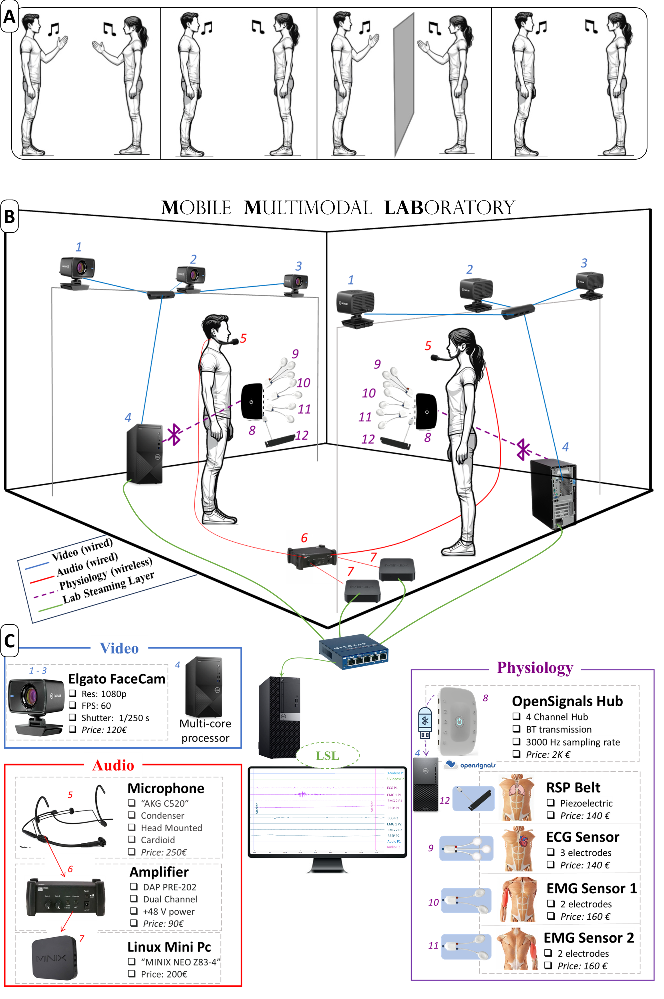

# Preprocessing of Multimodal Data {#sec-preproc}
Following multimodal data acquisition via the LabStreamingLayer (LSL), the resulting dataset for both participants consisted of (i) a single .xdf file containing all LSL-recorded data streams (time-marked events, video frame-index metadata, audio time-series, ECG, two EMG channels and respiration time-series) and (ii) two externally stored composite videos (each one containing three frame-synced videos from each camera trios). 

This section details the pipeline we employed to transform this unified .xdf file recording and corresponding raw videos into structured data sets ready for further analyses. Specifically, we outline the processes of **(-@sec-preproc-extract)** extracting and converting each stream, **(-@sec-preproc-segment)** segmenting the streams based on common LSL timestamps, **(-@sec-preproc-clip)** clipping the raw videos, and **(-@sec-preproc-merge)** merging the clipped videos with the corresponding audios. A graphical representation of this preprocessing pipeline can be seen in Figure 2. 

::: {#fig-preprocessing fig-scap="A graphical illustration of the preprocessing pipeline"}
{width=90%}

NEED THE PROPER FIGURE From the unitary XDF file (A), we extracted each stream and converted it into a workable .csv format (B). We then segmented each stream (C) based on the common LSL time stamps of the Marker Events (denoting relevant events during the experimental task), resulting in multiple time segments for each data stream (corresponding to the relevant experimental periods). The externally stored composite videos (each containing three frame-synced videos from each camera trio) were then clipped according to corresponding video frame numbers in the shared LSL time (D) and aligned to the corresponding (and now synchronized) audio recordings (E). The color-coding of the streams represents the different modalities (blue: video, red: audio, purple: physiology), differently shaded for P1 and P2. 
:::

## Stream Extraction & Conversion {#sec-preproc-extract}
We use a custom Python script to extract the individual multimodal streams from the unified .xdf file, convert them into workable .csv files, and segment them based on the marker events timestamps.

::: {.content-visible when-format="html"}

[Quarto Link with Script and Explanation: MML_XDF_Preprocessing.ipynb]

:::

Using the pyxdf library, the script loads and parses the .xdf files hierarchically at the meta-data level of each stream (which includes the stream’s name, type, nominal sampling rate, channel labels, and time stamps).

::: {.content-visible when-format="html"}
[CODE: 2_PREPROCESSING/1_XDF_PROCESSING/MML_XDF_Preprocessing.ipynb#xdf-load]
[CODE: 2_PREPROCESSING/1_XDF_PROCESSING/MML_XDF_Preprocessing.ipynb#xdf-stream-metadata].
Because stream metadata data may vary across sessions depending on device configuration or recording order, we performed a naming standardization procedure according to the experiment-specific configuration (e.g., explicitly assigning streams to Participant 1 or Participant 2 and labeling physiological channels consistently) to ensure consistent referencing across streams. 
[CODE: 2_PREPROCESSING/1_XDF_PROCESSING/MML_XDF_Preprocessing.ipynb#xdf-load-rename].

:::

Each stream is then extracted as  the raw time series together with their corresponding LSL timestamps, organized into a tabular structure and exported as a workable .csv file.  
Audio streams were separately converted into standard .wav files using the `SciPy` library at their declared sampling frequency (i.e., 16 kHz). An additional noise-reduction using the `noisereduce` library [@sainburgTimsainbNoisereduceV102019] was also applied with a pre-defined stationary threshold of 1.5 to reduce background noise. 

::: {.content-visible when-format="html"}

[CODE: 2_PREPROCESSING/1_XDF_PROCESSING/MML_XDF_Preprocessing.ipynb#xdf-denoise].

:::

## Stream Segmentation {#sec-preproc-segment}
In the same script, we also perform a temporal segmentation of each .csv data stream using the shared LSL timestamps of the Event Marker stream, corresponding to our experimentally relevant time boundaries (i.e., start and end trial of each condition).

::: {.content-visible when-format="html"}

[CODE: 2_PREPROCESSING/1_XDF_PROCESSING/MML_XDF_Preprocessing.ipynb#xdf-seg-markers].

:::

This is achieved by identifying the relevant start-end pairs based on a flexible, user-defined segmentation method using the shared LSL time (e.g., full-session segmentation, condition based segmentation, trial-level segmentation, custom defined timings). The final output of this preprocessing stage was hierarchically organized into folders structured by participant ID, session number and type of segmentation, allowing for organized multimodal post-processing. 

::: {.content-visible when-format="html"}

[CODE: 2_PREPROCESSING/1_XDF_PROCESSING/MML_XDF_Preprocessing.ipynb#xdf-csv-export].

:::

## Clipping Raw Videos {#sec-preproc-clip}
To align the externally saved composite videos with the rest of the LSL streams, a custom Python script clips each composite video based on the corresponding frame indices that were sent to LSL during data collection and processed into workable.csv (@sec-preproc-clip)

::: {.content-visible when-format="html"}

[Quarto Link with Script and Explanation MML_AudioVideo_Sync] 

:::

Specifically, using the first and last frame indices from each LSL .csv file (step 2.2), the script trims the corresponding raw video using `OpenCV` [@bradskiOpenCVLibrary2000] to that exact frame range. 

::: {.content-visible when-format="html"}
[CODE: 2_PREPROCESSING/2_AudioVideo_Sync/MML_AudioVideo_Sync.ipynb#video-lsl-frame-range].

:::

Importantly, the output frame rate is calculated empirically from the LSL data (frame count divided by elapsed time) rather than taken from video metadata, since the latter may not reflect actual frame rate due to dropped frames or other irregularities during acquisition.

::: {.content-visible when-format="html"}

[CODE: 2_PREPROCESSING/2_AudioVideo_Sync/MML_AudioVideo_Sync.ipynb#video-cfr-plan].

:::

## Merging Clipped Videos with Audios {#sec-preproc-merge}
To verify that trimmed video and audio are perfectly synchronized, the same script also allows the user to merge these video-audio pairs using `ffmpeg`. The video stream is copied without re-encoding to preserve the original visual quality, while the audio stream is re-encoded as AAC, producing a single merged audio-video file in which the two modalities are temporally aligned according to the shared LSL timing.

::: {.content-visible when-format="html"}
[CODE: 2_PREPROCESSING/2_AudioVideo_Sync/MML_AudioVideo_Sync.ipynb#av-ffmpeg-merge].
(In case further debugging is needed due to audio-video de-synchronizations, the script includes an optional step in which the LSL timestamps and frame numbers (from the LSL .csv file) are overlaid onto each frame of the trimmed videos (which already contain a running frame counter created during recording with the  MML_Video3Cameras_LSL.py script). This allows the user to visually inspect any possible mismatch between the LSL timing/frames and the native video frames) 
[CODE: 2_PREPROCESSING/2_AudioVideo_Sync/MML_AudioVideo_Sync.ipynb#av-overlay-lsl].

:::
