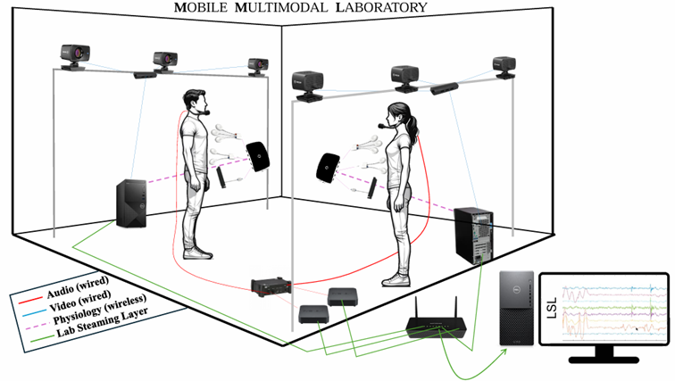

## About project

MobileMultimodalLab (MMLab) is a project initiated by researchers at Donders Center for Cognition. It aims to provide a lab setup for anyone interested in studying multimodal interactive behaviour - including acoustics, body movement, muscle activity, eye movements, and so on.

To achieve this, we are working on a comprehensive coding library, accompanied by a practical manual, that shall help researchers to build their own MobileMultimodalLab. Our guiding principles are:

- Open-source resources - All code and documentation is freely available to everyone
- Low-cost equipment - We want to build the setup with as little monetary cost as possible (i.e., less than 10K)
- Portable setup - The setup should be easily transportable across locations

::: {.content-visible when-format="html"}

:::

The MML setup originally consists of

- multiple frame-synced 2D cameras that allow for 3D motion tracking
- multiple microphones for acoustic analysis
- multiple physiological sensors for measuring heart rate, muscle activity, and respiration

To ensure that all the signals are synchronized, we use the Lab streaming layer (https://github.com/sccn/labstreaminglayer), a software that synchronizes different data streams with sub-millisecond precision, crucially simplifying the data collection process and subsequent processing.

Additionally, the setup is build in a modular way, so that anyone can add or remove equipment and recording from the default setup as long as these devices are LSL compatible

## Acknowledgements

We would like to thank ...

## Contact

## How to cite

## Funding and support